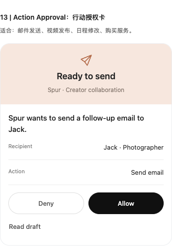
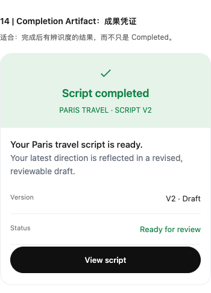

# Spur Agent Workspace 二十种自适应 UI 设计规范与交互实现及真机版本接续说明

记录日期：2026-11-04。对应版本：Spur iOS 1.0.2（1037）。

本文记录本轮已经完成的设计、交互和实现边界，作为后续调整 Agent Workspace 的接续依据。用户查看修正版后反馈“OK，挺好的”；这代表本轮设计方向获得认可，不等于逐项真实外部执行都已验收。

## 1. 产品目标和本轮范围

Spur 的核心链路是：

```text
Ring 或 App 录音
  → 转写
  → Personal Agent 理解、分类、提取事项
  → Agent Workspace 按内容与状态展示
  → 用户确认／Agent 执行／结果反馈
```

本轮重点是展示与交互，不是重做后端。

- 保留 V2 App 最新 UI、现有导航、录音、自动理解和 Personal Agent 连接。
- 不新增 Memory 页面：想法、灵感、知识也在 Agent Workspace 内展示。
- 保留完整 20 个可操作示例，直接在首页查看。
- 首页不为每个示例贴 Demo 标签；模拟发送、授权和修改文件等，在操作反馈中说明边界。
- 真实内容优先；示例整体可收起，不能写入真实录音库或任务台账。
- 首页主要展示预览；长正文、完整报告、来源和文件信息由用户点击后查看。

## 2. 最重要的设计原则

**统一设计语言，不统一容器形状。界面随任务变化，不靠增加卡片表达变化。**

### 2.1 根据信息分量选择展示形式

| 内容 | 合适的展示 | 应避免 |
|---|---|---|
| 一句话更新 | 无边框文字通知 | 一件小事占一张大卡片 |
| 简单确认 | 行内问题和选项 | 必须跳页才能回答 |
| 个人待办 | 紧凑清单行 | 每条待办都有重复背景和大标题 |
| Agent 执行中 | 阶段、当前上下文 | 虚假百分比和整屏工具日志 |
| 复杂报告 | 封面、摘要、展开入口 | 首屏铺满正文 |
| 重要外部动作 | 明确授权面板 | 把批准直接显示成执行成功 |
| 文件成果 | 文件类型、元信息、预览与修改入口 | 只有一个 Completed 标签 |
| 已完成的轻量工作 | 一行完成事件 | 所有历史结果永远占据大面积 |

### 2.2 先概览，再深入

默认展示：标题、简短摘要、关键状态、必要操作。

用户点开后展示：完整正文、详细草稿、报告分节、来源、成果链接、补充输入。

不是要求所有内容都隐藏：短问题、单行待办、两三句修改对比本身就是合适的预览。但长脚本、长研究结果绝不能默认把首页撑成全文阅读页。

## 3. 视觉规范

以用户确认的独立 20 种示范和授权／成果参考图为基准。

- 白色或接近白色背景，深色文字。
- 限制大面积彩色背景、阴影、装饰图标和重复边框。
- 蓝色用于 Agent 活动、选择和部分交互；绿色用于成功；暖色用于需要确认的重点动作。
- 主要按钮使用黑色／深色，次要按钮使用白底、浅边框。
- 简单内容无容器或仅用轻量行；重要成果才用圆角面板。
- 中英文职责：示例名称与适用说明便于中文讨论，产品内示例内容主要为英文。

当前实现中的主要样式值：

| 项目 | 当前值／处理 |
|---|---|
| 主文字 | `#1B1B1B` |
| 次级文字 | `#777777` |
| 主要按钮 | `#101010` |
| 授权标题区 | `#F7E7DE`，浅桃色 |
| 成果标题区 | `#E5F3E9`，浅绿色 |
| 成果强调文字 | `#148348` |
| 重点面板圆角 | 19 |
| 标题区 | 居中小图标、标题、副标题；高度至少约 123 |
| 主要触控按钮 | 最小高度 44 |
| 信息行 | 左标签、右数值，轻分隔线，最小高度约 51 |

这些值是当前实现记录，后续统一调样式应修改共享样式，不在各示例里随意增加新配色。

## 4. 首页结构与访问方式

```text
Agent Workspace
  ├─ spur.／原有导航
  ├─ 问候与日期
  ├─ 真实事项、真实执行结果与状态
  ├─ Adaptive Agent UI · 20 interaction patterns
  │    ├─ All 20 examples：默认完整展示
  │    ├─ Today composition：精选首页组合
  │    ├─ 01–20：编号、名称、适用说明、实际组件
  │    └─ Hide examples／Show examples：整体收起或展开
  └─ 原有设置入口与底部命令输入
```

底部命令输入仍是实际 Agent 对话入口，不是把示例按钮接到真实执行。

`Today composition` 目前选择：标题选项、行动授权、执行阶段、脚本成果、轻量完成事件、下一步建议、录音转化时间线。它用于看组合节奏，不替代完整 20 项。

## 5. 完整二十种展示方式

| 编号 | 模式与类型键 | 展示／适用场景 | 交互与默认状态 |
|---|---|---|---|
| 01 | Minimal Notification `notification` | 一句话 Agent 更新，无边框 | 点击查看脚本；正文默认关闭 |
| 02 | Inline Question `question` | 行内确认，直接回答 | Continue／Tomorrow，选择后替换成反馈，可更改 |
| 03 | Compact Checklist `todo` | 紧凑待办行，时间靠右 | 勾选完成／取消，点击行可查看详情 |
| 04 | Execution Status `agent_execution` | Searching／Analyzing／Drafting／Ready 阶段 | 示例手动推进，可重播；无虚假百分比 |
| 05 | Research Report `research_report` | 封面、标题、摘要、元信息 | 点击 View full report 查看完整研究方向 |
| 06 | Embedded Analytics `analytics` | 指标与小型折线图 | 点击日期／图点看数值，展开洞察；标明指标是示意数据 |
| 07 | Email Draft `approval` | 草稿摘要、收件人、审阅动作 | 草稿先显示短预览；完整草稿需点击；可编辑、保存、取消、批准，不发送 |
| 08 | Capture Timeline `recording` | 录音元信息、原文节选、转化步骤 | 默认节选，点击展开原文；步骤逐项展开，无虚假播放按钮 |
| 09 | Choice Selector `choice` | 多个标题方向 | 横向选择，显示当前选择，可切换 |
| 10 | Schedule Timeline `schedule` | 时间列与轻量事件轴 | 点击事件展开，不写入真实日历 |
| 11 | Learning Feedback `memory_update` | Agent 推断的偏好 | 区分未确认与确认，允许纠正；仅示例状态，不保存为真实永久偏好 |
| 12 | Completion Event `completion` | 单行完成更新 | 点击展开摘要，不用大卡片占据首页 |
| 13 | Action Approval `action_approval` | 重要外部行动授权 | 浅桃标题区、Recipient／Action 信息行、等宽 Deny／Allow；草稿默认折叠 |
| 14 | Completion Artifact `completion_artifact` | 有辨识度的成果凭证 | 浅绿标题区、版本和状态、整行 View script；脚本默认折叠 |
| 15 | Visual Decision `visual_decision` | 视觉方案比较 | 两列 4:3 图片，点击选择和更改；复用巴黎、圣托里尼现有资源 |
| 16 | Generated Deliverable `generated_deliverable` | PPT 等文件成果 | 文件图标、名称、元信息、简述；Preview／Refine 同行；预览与修改输入默认关闭 |
| 17 | Before / After `comparison` | 脚本、标题、邮件优化 | Original／Spur’s revision 切换，不丢失两版内容 |
| 18 | Contextual Next Action `next_action` | 完成后的相关下一步 | Create outline／Not now；接受只产生模拟反馈，拒绝后收起 |
| 19 | Recovery State `recovery` | 执行遇阻，保留上下文 | Retry／Return to draft，说明原草稿安全，不实际发送 |
| 20 | Task Transformation `task_transformation` | 同一任务从捕捉到结果 | 稳定任务身份，原位改变形态；批准、成功、失败是不同事件 |

## 6. 两种重点面板的结构

### 6.1 行动授权：13

```text
┌─────────────────────────────────┐
│ 浅桃色标题区                     │
│ 小发送图标                       │
│ Ready to send                   │
│ Spur · Creator collaboration    │
├─────────────────────────────────┤
│ 一句行动说明                     │
│ Recipient       Jack · Photographer│
│ Action                 Send email│
│ [ Deny ]             [ Allow ]  │
│ Read draft                      │
└─────────────────────────────────┘
```

关键点：标题放在有色区域，信息在白色区域；两个按钮等宽。不是“大插画 + 大段正文 + 两个小按钮”。批准后给出已批准反馈，不能直接宣称已发送。

### 6.2 成果凭证：14

```text
┌─────────────────────────────────┐
│ 浅绿色标题区                     │
│ 成功图标                         │
│ Script completed                │
│ PARIS TRAVEL · SCRIPT V2         │
├─────────────────────────────────┤
│ 成果标题与简短说明               │
│ Version                 V2 · Draft│
│ Status           Ready for review│
│ [          View script         ]│
└─────────────────────────────────┘
```

关键点：完成状态有独立视觉，但完整脚本不默认展示；查看入口整行可点。

## 7. 同一个任务如何变化

示例稳定任务 ID：`example-jack-followup`。

```text
Captured：录音意图
  → Executing：准备跟进邮件
  → Needs approval：授权面板
      ├─ Denied：不行动，可返回草稿
      └─ Approved：已批准，等待执行
          ├─ 显式模拟成功事件 → Completed
          └─ 显式模拟失败事件 → Failed
                                      ├─ Retry
                                      └─ Return to draft
```

必须保留的语义：

- 授权是用户决定，不是成功凭证。
- 成功由执行结果事件决定。
- 状态变化更新同一任务，不为每一步追加一个重复任务。
- 模拟任务不调用真实外部服务；显示发送成功时同时说明是模拟结果。

## 8. 真实 Agent 结果的默认折叠

除示例外，1037 还修复了工作区真实结果铺满全文的问题。

`PersonalAgentSection` 当前规则：

1. 执行中显示已有真实进度；不编造额外阶段。
2. 已完成默认仅显示三行文字预览。
3. 点击“查看完整结果”后，展示完整 Markdown、来源和成果链接。
4. 点击“收起结果”返回预览。
5. 失败时保留重试；完成时不重复展示通用提交按钮。

来源和成果链接随完整结果一起展开，不在首页堆成长列表。

## 9. 工程结构与真实／示例边界

仓库：`/Users/x/X/space/spur`。

以下路径相对仓库根目录：

| 文件 | 职责 |
|---|---|
| `V2/appV2/app_mobile/src/adaptive/model.ts` | 20 种模式类型、示例数据结构、真实事项展示选择函数 |
| `V2/appV2/app_mobile/src/adaptive/examples.ts` | 20 条虚构 Creator 示例、编号名称、适用说明、示意指标 |
| `V2/appV2/app_mobile/src/adaptive/Patterns.tsx` | 模式组件、共享样式、按钮、预览、重点面板、动效 |
| `V2/appV2/app_mobile/src/adaptive/WorkspaceExamples.tsx` | 完整示例、Today 组合、整体收起、同任务生命周期 |
| `V2/appV2/app_mobile/src/adaptive/RealAdaptiveItem.tsx` | 真实事项适配；不使用示例反馈伪造真实状态 |
| `V2/appV2/app_mobile/src/components/AgentDashboard.tsx` | 首页真实内容与示例区的组合 |
| `V2/appV2/app_mobile/src/components/IntentWorkspace.tsx` | 真实意图台账、来源关联、详情与实际操作 |
| `V2/appV2/app_mobile/src/components/RecordingReplyCard.tsx` | 录音回复及 Personal Agent 结果的折叠展示 |
| `V2/appV2/app_mobile/__tests__/AdaptiveWorkspace.test.tsx` | 20 种模式、交互、默认折叠、授权／执行区分 |
| `V2/appV2/app_mobile/__tests__/AgentDashboard.test.tsx` | 工作区与真实结果展开行为 |

真实数据和示例数据的要求：

- 示例不写入真实录音 store、意图台账和任务列表。
- 示例按钮不调用真实邮件、发布、日历或 Agent 执行接口。
- 真实来源、数字、状态和成果必须来自实际数据，不能使用示例封面、指标或进度冒充。
- 展示规则是确定性的本地规则，不为决定 UI 再调用一次大模型。
- 20 种示例完成，不代表所有真实业务都已经具备相应的数据或外部执行能力。

## 10. 真实事项如何选择外观

`presentationForTask` 的判断顺序：

1. 已完成：有正文分节选成果类，否则选轻量完成事件。
2. 工作中／准备中：选执行状态。
3. 想法：选轻量通知。
4. 存在待答问题／需要澄清：选行内问题。
5. 邮件：选审批类。
6. 有真实指标：选分析类。
7. 报告：选研究报告类。
8. 脚本：选文件成果类。
9. 承诺／提醒：选待办类。
10. 其他：轻量通知。

当前 `RealAdaptiveItem` 已直接使用轻量通知、完成事件、紧凑待办和行内问题；复杂真实内容继续交给已有 `IntentUpdateCard` 等组件。因此“选择了某种类型”不等于已经把该类型的示例组件原样用于真实数据。后续替换复杂真实渲染时，需补足真实数据映射，不能直接套用虚构内容。

## 11. 动效、触控与布局要求

- 点击展开、选择和状态变化时使用轻量过渡。
- 尊重系统减少动态效果设置。
- 不持续闪烁、循环跳动或假装后台持续推进。
- 不用纯装饰性按钮，所有可见操作都应有清晰反馈。
- 小屏按钮可点，标题和值允许换行，不能横向溢出。
- 修改共享按钮时同时检查等宽授权按钮、整行成果按钮和轻量文本入口。

## 12. 实际验证与安装状态

本轮已完成：

- TypeScript 检查通过。
- 改动源码 ESLint 通过。
- 完整 Jest：33 套／234 项通过；最后的空白节点清理后又通过对应工作区测试。
- 使用 App 同一套 React Native 组件，经 React Native Web 渲染检查 390／320 宽度，无横向溢出、无页面 JS 错误，20 项存在。
- 浏览器交互验证：脚本默认关闭，点击后出现；批准仅显示批准反馈，不直接变成发送成功。
- iOS Release 1037 构建成功，已安装到 eFLY 并启动，包名 `com.spur.recordingring`。
- 用户对修正版反馈“OK，挺好的”。

浏览器同源组件检查不是 iPhone 截图或全部真机行为验收；两者不能混称。

本轮截图证据（同源组件浏览器渲染）：

### 授权卡



### 成果凭证



### 文件交付


## 13. 后续调整的检查清单

1. 不删减已经确认保留的 20 个示例。
2. 不把折叠正文重新默认展开，不把来源列表直接铺满首页。
3. 先对照确认稿核对层级、按钮、信息行与留白，再检查代码逻辑。
4. 不能只凭测试通过、构建成功或安装成功宣称视觉完成。
5. 真实任务优先，示例不污染真实状态；不新增 Memory 页。
6. 同任务状态原位变化，批准与执行成功始终分离。
7. 对照小屏实际渲染；真实 iPhone 检查与浏览器组件检查分开记录。
8. 未来接更多真实业务时，先确认数据契约、来源和权限，再决定展示，不反向从示例生成“真实结果”。

## 14. 相关历史记录

- `Agent-Workspace首页十八种自适应展示与同一任务状态变化交互示例实现记录.md`：1036 阶段记录，不能作为最终视觉验收依据。
- `Agent-Workspace二十种示例按确认稿重新排版与默认折叠修复记录.md`：1037 修复摘要。
- `录音自动理解直连硅谷Personal-Agent并统一进入Agent-Workspace的实现与真机验收记录.md`：前一阶段自动分析与 Agent 集成记录。

本文优先记录 1037 的 UI 设计与边界。云端运行状态和未来源码仍需现场核对；本文不保存令牌、模型密钥或登录密码。
